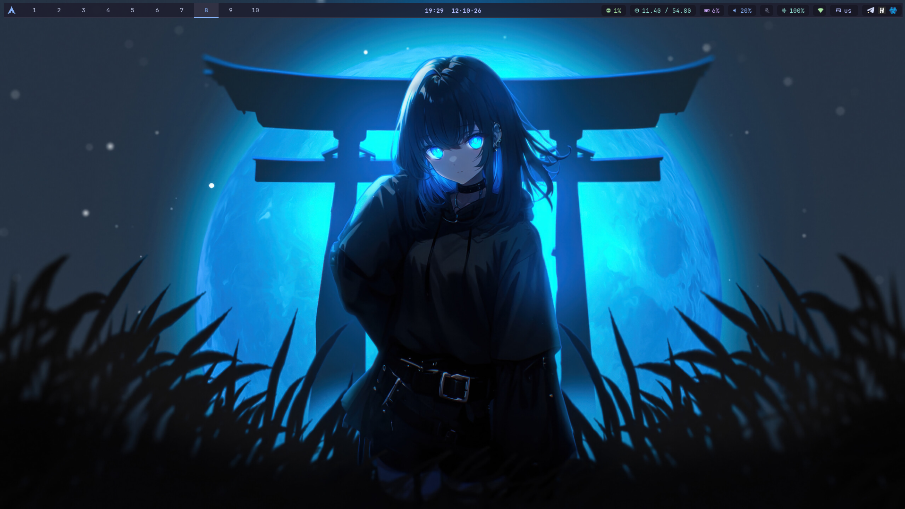

# Sway конфиг — Catppuccin Mocha

Тема: **Catppuccin Mocha** для sway + waybar + foot + fuzzel + mako.

---



## Установка

### 1. Пакеты

```bash
# Основное
sudo pacman -S sway autotiling waybar foot fuzzel mako \
               grim slurp wl-clipboard cliphist wlsunset \
               thunar fastfetch brightnessctl papirus-icon-theme \
               ttf-jetbrains-mono-nerd libnotify python

# zsh + oh-my-zsh (если нужен)
sudo pacman -S zsh
sh -c "$(curl -fsSL https://raw.githubusercontent.com/ohmyzsh/ohmyzsh/master/tools/install.sh)"
```

### 2. Разложить файлы

```bash
git clone https://github.com/Shyzeron/sway-catppuccin.git
cd sway-catppuccin
./install.sh
```

Скрипт копирует всё из `.config/` репозитория в `~/.config/`. Если у тебя уже есть конфиги
sway/waybar/foot/fuzzel/mako, они будут сохранены рядом как `<имя>.bak-<дата>`.

Вручную можно так: `cp -r .config/. ~/.config/`

### 3. Настроить мониторы

Открой `~/.config/sway/config` и поменяй секцию `Output configuration` под свои мониторы.
Имена мониторов можно узнать командой:

```bash
swaymsg -t get_outputs
```

### 4. Настроить координаты для night light

В конфиге найди строку `wlsunset` и поменяй координаты на свои:

```bash
# Узнать координаты
curl ipinfo.io
```

### 5. GPU мониторинг в waybar

Скрипт автоматически определяет GPU. Для NVIDIA нужен пакет:

```bash
sudo pacman -S nvidia-utils
```

### 6. Запустить

```bash
sway
```

---

## Хоткеи

> `$mod` = клавиша Super (Win)  
> Все хоткеи работают независимо от раскладки клавиатуры (флаг `--to-code`)

### Основные

| Хоткей | Действие |
|--------|----------|
| `$mod+Return` | Открыть терминал (foot) |
| `$mod+D` | Лаунчер приложений (fuzzel) |
| `$mod+E` | Файловый менеджер (thunar) |
| `$mod+Q` | Закрыть окно |
| `$mod+Shift+C` | Перезагрузить конфиг sway |
| `$mod+Shift+E` | Выйти из sway |

### Навигация

| Хоткей | Действие |
|--------|----------|
| `$mod+H/J/K/L` | Фокус влево/вниз/вверх/вправо |
| `$mod+←/↓/↑/→` | Фокус стрелками |
| `$mod+Shift+H/J/K/L` | Переместить окно |
| `$mod+Shift+←/↓/↑/→` | Переместить окно стрелками |

### Воркспейсы

| Хоткей | Действие |
|--------|----------|
| `$mod+1..0` | Переключиться на воркспейс 1–10 |
| `$mod+Shift+1..0` | Перенести окно на воркспейс 1–10 |
| Клик мышью в баре | Переключить воркспейс |

### Раскладка окон

| Хоткей | Действие |
|--------|----------|
| `$mod+B` | Разделить горизонтально |
| `$mod+V` | Разделить вертикально |
| `$mod+S` | Режим stacking |
| `$mod+W` | Режим tabbed |
| `$mod+T` | Toggle split |
| `$mod+F` | Полноэкранный режим |
| `$mod+Space` | Переключить фокус tiling/floating |
| `$mod+Shift+Space` | Floating toggle |
| `$mod+R` | Режим изменения размера |
| `$mod+A` | Фокус на родительский контейнер |

### Scratchpad

| Хоткей | Действие |
|--------|----------|
| `$mod+Shift+-` | Отправить окно в scratchpad |
| `$mod+-` | Показать/скрыть scratchpad |

### Скриншоты

| Хоткей | Действие |
|--------|----------|
| `Print` | Выделить область → файл + буфер |
| `Shift+Print` | Текущий монитор → файл + буфер |
| `Ctrl+Print` | Активное окно → файл + буфер |

Скриншоты сохраняются в `~/Pictures/Screenshots/`

### Утилиты

| Хоткей | Действие |
|--------|----------|
| `$mod+Shift+V` | История буфера обмена (cliphist) |
| `$mod+Shift+B` | Показать/скрыть waybar |
| `Alt+Shift` | Переключить раскладку ru/en |
| Медиаклавиши | Громкость, яркость |

### Waybar

| Элемент | Действие |
|---------|----------|
| Воркспейсы | Клик — переключить |
| Громкость | Скролл — регулировка; клик — mute; ПКМ — pavucontrol |
| CPU/RAM | Клик — htop в терминале |

---

## Структура файлов

```
~/.config/
├── sway/
│   ├── config          # основной конфиг
│   ├── term.sh         # скрипт запуска терминала (fastfetch + zsh, без zsh — sh)
│   ├── gaps-toggle.sh  # переключение отступов ($mod+G)
│   └── screenshot.sh   # скриншоты (Print / Shift+Print / Ctrl+Print)
├── waybar/
│   ├── config          # конфиг панели
│   ├── style.css       # стили (Catppuccin Mocha)
│   ├── launch.sh       # запуск waybar с перезапуском при падении
│   └── scripts/
│       ├── gpu.sh      # мониторинг GPU
│       └── distro.sh   # иконка дистрибутива
├── foot/
│   └── foot.ini        # конфиг терминала
├── fuzzel/
│   └── fuzzel.ini      # конфиг лаунчера
└── mako/
    └── config          # конфиг уведомлений
```
